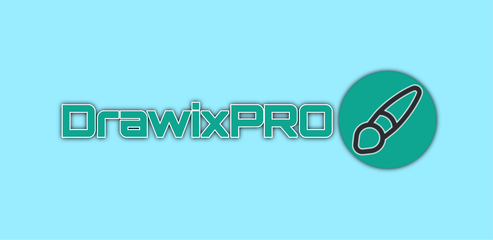
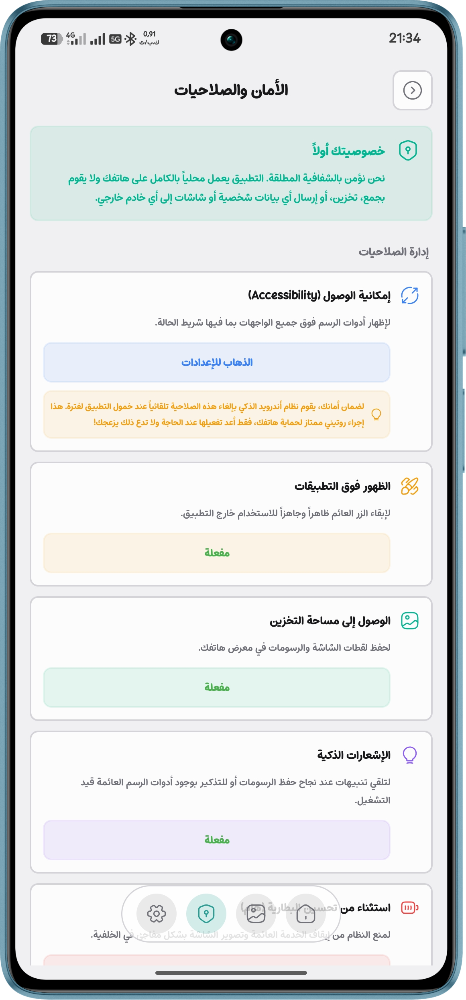
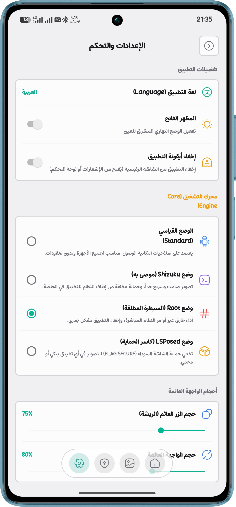

<div align="center">
  
  <h1>Drawix Pro</h1>
  <p><strong>Draw on your screen. Explain your ideas. Capture the moment.</strong></p>
  <a href="https://github.com/elhizazi1/DrawixPRO/releases/tag/v1.1.0"></a>
  
  <a href="LICENSE"></a>
  <br />
  
  
  
  <a href="https://github.com/elhizazi1/DrawixPRO/actions/workflows/android.yml"></a>
  <p><a href="README.md">English</a> · <a href="README_AR.md">العربية</a></p>
  
  <p><a href="https://github.com/elhizazi1/DrawixPRO/releases/download/v1.1.0/app-release-sign.apk"></a> <a href="https://drawix.siwane.xyz"></a></p>
  <p><a href="https://github.com/elhizazi1/DrawixPRO/releases">Releases</a> · <a href="https://github.com/elhizazi1/DrawixPRO/issues">Report an issue</a> · <a href="CHANGELOG.md">Changelog</a></p>
</div>

---

## ✨ Overview

Drawix Pro is an open-source Android application for drawing and explaining directly over your screen. Floating annotation tools, four screenshot engines and a local gallery bring visual explanations, tutorials and everyday screen markup into one workspace.

## 🎨 Features

| Tool | What it offers |
| --- | --- |
| 🖌️ Brush & shapes | Draw freely and highlight areas with geometric shapes. |
| 🔤 Text | Add written explanations directly on screen. |
| ☄️ Laser pointer | Guide attention with a fading comet-style trail. |
| 🛡️ Mosaic / Censor | Obscure sensitive areas using square or circular masks. |
| 📸 Capture | Save screenshots as PNG or JPEG. |
| 🖼️ Local gallery | Browse thumbnails, zoom, share and delete images. |
| 🎛️ Floating controls | Customize button size, shape, icon and color, plus panel opacity, corners and borders with live preview. |
| 🌗 Material 3 | System, light and dark themes, dynamic and custom colors. |
| 🌐 Localization | English, Arabic, French, Spanish, Portuguese, Russian, Hindi and Chinese. |

## 📱 Screenshots

<p align="center">
  
  
  
  
</p>

## 🚀 What's new in 1.1.0

- Android build configuration updated to compile and target SDK 37 (Android 17).
- Adaptive Material 3 appearance and expanded color customization.
- Live floating button and panel customization while preserving overlay state during theme changes.
- Refined grouped cards, spacing, navigation and RTL transitions.
- Improved gallery thumbnails, image viewing and share/delete controls.
- Corrected duplicate Shizuku permission declaration and improved LSPosed capture compatibility.
- Removed developer-only manager-launch and diagnostic-copy actions from the capture engine screen.
- Manual GitHub Actions selection for debug APK, release APK and AAB builds.

## ⚙️ Four screenshot engines

| Engine | Requirements and behavior |
| --- | --- |
| 🛡️ Standard | Accessibility capture on Android 11+; system capture consent on Android 7–10. |
| ⚡ Shizuku | Running, authorized Shizuku service. Root is not required when started via ADB. |
| 🔑 Root | Explicit root authorization for system screenshot commands. |
| 🧩 LSPosed | Enabled module and appropriate scopes; restart Android after updating the enabled module. Includes Android 17 capture compatibility improvements. |

Root is not required for basic drawing. Capture availability depends on device, Android version, permissions and framework configuration. Protected content may remain unavailable.

## 📦 Installation & compatibility

| Specification | Value |
| --- | --- |
| Version | 1.1.0 |
| Version code | 2 |
| Package | `xyz.siwane.drawix.pro` |
| Minimum Android | 7.0 (API 24) |
| Target SDK | 37 |

1. Open the [1.1.0 release](https://github.com/elhizazi1/DrawixPRO/releases/tag/v1.1.0) and download the signed APK when available.
2. Install the APK, allowing installation from the selected source if Android requests it.
3. Enable the floating tools and grant the required permissions. Configure an advanced capture engine only if needed.

## 🔋 Battery & privacy

Drawing and capture run locally. Screenshots are taken on demand, not continuously while idle. The floating service remains active with a persistent notification while enabled; disable it when no longer needed. Battery consumption varies by device and workload.

Read [battery usage and measurement guidance](docs/BATTERY.md), the [privacy policy](privacy.html) and [security policy](SECURITY.md). Website advertising and external fonts have separate privacy implications.

## 🛠️ Build from source

The public website, metadata and documentation live at the repository root. Android source is expected in `DrawixPro/`, with `app/`, Gradle wrapper and build configuration; the standalone Android source archive contains those files at its root.

Requirements: **JDK 17 · Android SDK 37**.

From the Android source directory:

```sh
chmod +x gradlew
./gradlew :app:assembleDebug :app:lintDebug
./gradlew :app:assembleRelease :app:bundleRelease
```

### GitHub Actions & signing

Open **Actions → Android build → Run workflow**, select `debug`, `release`, `aab` or `all`, and confirm. Pushes do not trigger builds automatically.

Configure repository secrets `KEYSTORE_BASE64`, `KEYSTORE_PASSWORD`, `KEY_ALIAS` and `KEY_PASSWORD` for APK signing. Without them the release APK is unsigned. The AAB also requires release signing before store distribution. Retain the original signing key for update compatibility.

The release metadata expects tag `v1.1.0` and signed asset `app-release-sign.apk`. The workflow's `DrawixPro-release-signed.apk` can be renamed to match. Metadata alone does not publish a release.

From the repository root:

```sh
python3 scripts/validate_release.py --source DrawixPro
```

## 🤝 Contributing

Report reproducible issues with Android version, app version, selected engine and relevant errors. Remove private information from screenshots and logs. Keep contributions focused and run relevant build and Lint checks. Report security concerns privately as described in [SECURITY.md](SECURITY.md).

## 📄 License & credits

Drawix Pro is distributed under the [GNU General Public License v3.0](LICENSE).

Developed by **Jamal El Hizazi** · Technical support by [Siwane.xyz](https://siwane.xyz).
