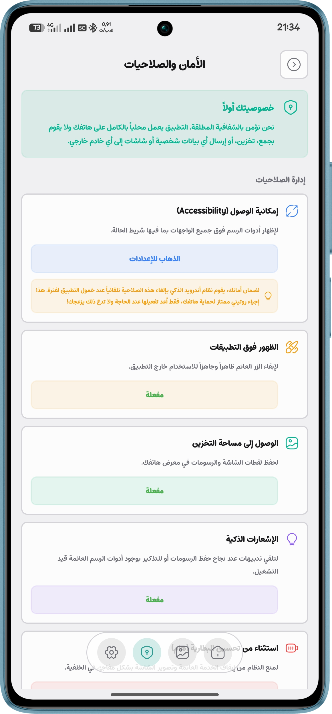
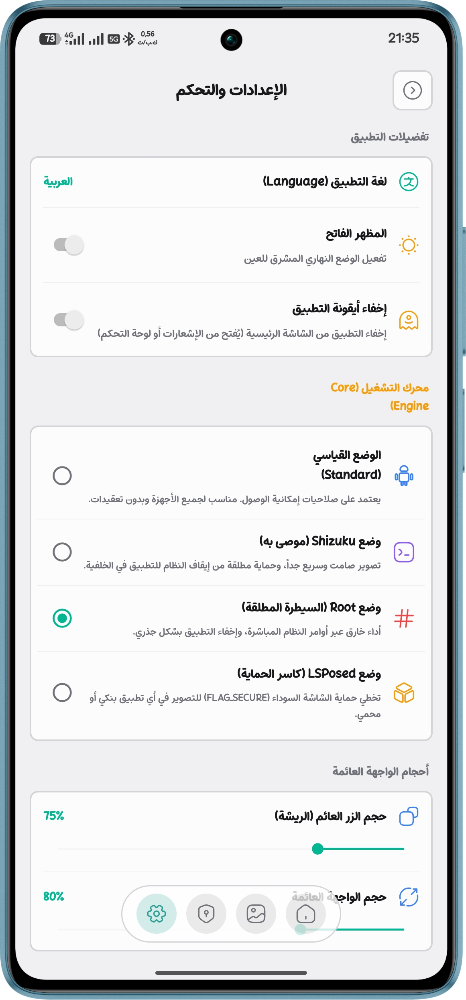

<div align="center">
  
  <h1>Drawix Pro | دراويكس برو</h1>
  <p><strong>ارسم على شاشتك. اشرح أفكارك. التقط اللحظة.</strong></p>
  <a href="https://github.com/elhizazi1/DrawixPRO/releases/tag/v1.1.0"></a>
  
  <a href="LICENSE"></a>
  <br />
  
  
  
  <a href="https://github.com/elhizazi1/DrawixPRO/actions/workflows/android.yml"></a>
  <p><a href="README.md">English</a> · <a href="README_AR.md">العربية</a></p>
  
  <p><a href="https://github.com/elhizazi1/DrawixPRO/releases/download/v1.1.0/app-release-sign.apk"></a> <a href="https://drawix.siwane.xyz"></a></p>
  <p><a href="https://github.com/elhizazi1/DrawixPRO/releases">الإصدارات</a> · <a href="https://github.com/elhizazi1/DrawixPRO/issues">الإبلاغ عن مشكلة</a> · <a href="CHANGELOG.md">سجل التغييرات</a></p>
</div>

---

<div dir="rtl" align="right">

## ✨ نبذة عن التطبيق

دراويكس برو تطبيق أندرويد مفتوح المصدر للرسم والشرح مباشرة فوق الشاشة، يجمع أدوات التوضيح العائمة وأربعة محركات لالتقاط الشاشة ومعرضًا محليًا للصور في مساحة عمل واحدة.

## 🎨 المميزات والأدوات

| الأداة | الوظيفة |
| --- | --- |
| 🖌️ الفرشاة والأشكال | الرسم الحر وإبراز المناطق بالأشكال الهندسية. |
| 🔤 النصوص | إضافة الشروحات الكتابية مباشرة على الشاشة. |
| ☄️ مؤشر الليزر | توجيه الانتباه بذيل مضيء متلاشٍ بنمط المذنب. |
| 🛡️ التعتيم | إخفاء المناطق الحساسة باستخدام أقنعة مربعة أو دائرية. |
| 📸 التقاط الشاشة | حفظ اللقطات بصيغة PNG أو JPEG. |
| 🖼️ المعرض المحلي | عرض المصغرات وتكبير الصور ومشاركتها وحذفها. |
| 🎛️ الأدوات العائمة | تخصيص حجم الزر وشكله وأيقونته ولونه وشفافية الصندوق وزواياه وحدوده مع معاينة مباشرة. |
| 🌗 Material 3 | مظهر النظام والفاتح والداكن والألوان الديناميكية والمخصصة. |
| 🌐 تعدد اللغات | العربية والإنجليزية والفرنسية والإسبانية والبرتغالية والروسية والهندية والصينية. |

## 📱 لقطات الشاشة

<p align="center">
  
  
  
  
</p>

## 🚀 الجديد في الإصدار 1.1.0

- تحديث إعدادات البناء والاستهداف إلى SDK 37 (Android 17).
- واجهة Material 3 متكيفة وخيارات ألوان أوسع.
- تخصيص مباشر للزر والصندوق العائمين مع الحفاظ على حالتهما عند تغيير المظهر.
- تحسين البطاقات والمسافات والتنقل وانتقالات RTL.
- تحسين مصغرات المعرض وعرض الصور وأدوات المشاركة والحذف.
- تصحيح تكرار تصريح Shizuku وتحسين توافق التقاط LSPosed.
- إزالة إجراءات فتح المدير ونسخ التقرير التشخيصي المخصصة للتطوير من شاشة المحركات.
- اختيار مخرجات APK وAAB يدويًا عبر GitHub Actions.

## ⚙️ محركات التقاط الشاشة الأربعة

| المحرك | المتطلبات وطريقة العمل |
| --- | --- |
| 🛡️ القياسي | إمكانية الوصول على Android 11 فأحدث، وموافقة النظام على Android 7–10. |
| ⚡ Shizuku | خدمة عاملة ومصرح بها؛ لا يتطلب Root عند تشغيلها عبر ADB. |
| 🔑 Root | منح صلاحية Root صراحةً لتنفيذ أوامر التقاط النظام. |
| 🧩 LSPosed | تفعيل الموديول ونطاقاته المناسبة وإعادة تشغيل الجهاز بعد تحديثه؛ يتضمن تحسينات توافق الالتقاط مع Android 17. |

لا تتطلب أدوات الرسم الأساسية صلاحية Root. يختلف توفر الالتقاط حسب الجهاز وإصدار النظام والصلاحيات وإعداد الإطار، وقد يبقى المحتوى المحمي غير متاح.

## 📦 التثبيت والتوافق

| المواصفة | القيمة |
| --- | --- |
| الإصدار | 1.1.0 |
| رمز الإصدار | 2 |
| اسم الحزمة | `xyz.siwane.drawix.pro` |
| الحد الأدنى | Android 7.0 (API 24) |
| SDK المستهدف | 37 |

1. افتح [صفحة الإصدار 1.1.0](https://github.com/elhizazi1/DrawixPRO/releases/tag/v1.1.0) وحمّل ملف APK الموقع عند توفره.
2. ثبّت التطبيق واسمح بالتثبيت من المصدر المحدد إذا طلب النظام ذلك.
3. فعّل الأدوات العائمة وامنح الصلاحيات اللازمة، واضبط محركًا متقدمًا عند الحاجة فقط.

## 🔋 البطارية والخصوصية

تعمل أدوات الرسم والالتقاط محليًا، ولا تُلتقط الصور باستمرار في وضع الخمول. تبقى الخدمة العائمة نشطة مع إشعار دائم أثناء تفعيلها؛ يمكن إيقافها عند انتهاء الاستخدام. يختلف استهلاك البطارية حسب الجهاز وطبيعة الاستخدام.

راجع [دليل استهلاك البطارية وقياسه](docs/BATTERY.md) و[سياسة الخصوصية](privacy.html) و[سياسة الأمان](SECURITY.md). تخضع إعلانات الموقع والخطوط الخارجية لاعتبارات خصوصية منفصلة.

## 🛠️ البناء من المصدر

توجد ملفات الموقع والبيانات والتوثيق في جذر المستودع. يُفترض وجود مصدر أندرويد داخل `DrawixPro/` بما فيه `app/` وملفات Gradle، بينما يحتوي أرشيف المصدر المستقل على هذه الملفات في جذره.

المتطلبات: **JDK 17 وAndroid SDK 37**.

من مجلد مصدر أندرويد:

</div>

```sh
chmod +x gradlew
./gradlew :app:assembleDebug :app:lintDebug
./gradlew :app:assembleRelease :app:bundleRelease
```

<div dir="rtl" align="right">

### GitHub Actions والتوقيع

من Actions ← Android build ← Run workflow، اختر `debug` أو `release` أو `aab` أو `all` وأكّد التشغيل. لا يبدأ البناء تلقائيًا بمجرد رفع التغييرات.

يتطلب توقيع APK إعداد أسرار المستودع `KEYSTORE_BASE64` و`KEYSTORE_PASSWORD` و`KEY_ALIAS` و`KEY_PASSWORD`. بدونها يكون APK الخاص بالإصدار غير موقع. يتطلب AAB أيضًا توقيع الإصدار قبل توزيعه عبر المتاجر. احتفظ بمفتاح التوقيع الأصلي لضمان توافق التحديثات.

تتوقع بيانات الإصدار الوسم `v1.1.0` والملف الموقع `app-release-sign.apk`. يمكن إعادة تسمية مخرج البناء `DrawixPro-release-signed.apk` ليتوافق معه. إعداد البيانات وحده لا ينشر الإصدار.

للتحقق من البيانات من جذر المستودع:

</div>

```sh
python3 scripts/validate_release.py --source DrawixPro
```

<div dir="rtl" align="right">

## 🤝 المساهمة

عند الإبلاغ عن مشكلة، أرفق إصدار أندرويد وإصدار التطبيق والمحرك المستخدم وخطوات إعادة إنتاج المشكلة والأخطاء ذات الصلة. احذف البيانات الخاصة من الصور والسجلات. حافظ على نطاق التعديلات وشغّل اختبارات البناء وLint المناسبة. تُرسل البلاغات الأمنية بصورة خاصة وفق [سياسة الأمان](SECURITY.md).

## 📄 الترخيص والتطوير

يُوزّع دراويكس برو بموجب [رخصة GNU GPL الإصدار الثالث](LICENSE).

تصميم وتطوير **Jamal El Hizazi** · بدعم تقني من [Siwane.xyz](https://siwane.xyz).

</div>
